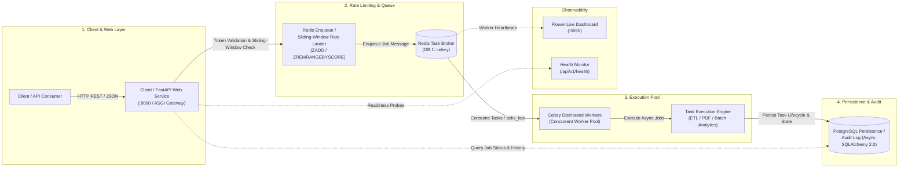

# ⚡ Distributed Task & Job Processing Engine

[](https://github.com/prachizala/distributed-task-engine/actions/workflows/ci.yml)
[](https://www.python.org/)
[](https://fastapi.tiangolo.com)
[](https://docs.celeryq.dev/)
[](https://redis.io/)
[](https://www.postgresql.org/)
[](https://www.docker.com/)
[](LICENSE)

An enterprise-grade, cloud-native distributed task queue and asynchronous job processing system engineered with **FastAPI**, **Celery**, **Redis**, **PostgreSQL (Async SQLAlchemy 2.0)**, **Docker Compose**, and automated **GitHub Actions CI/CD**.

Designed to offload resource-intensive workloads (ETL ingestion, PDF compilation, analytics pipelines, batch notifications) into asynchronous worker pools with persistent audit logs and sliding-window rate limiting.

---

## 🏛️ System Architecture



---

## 🚀 Key Architectural Capabilities

| Capability | Technical Implementation | Value |
|---|---|---|
| **Non-Blocking Ingestion** | FastAPI async endpoints + Uvicorn ASGI | Sub-millisecond job admission and horizontal throughput |
| **Enqueue Idempotency** | Redis `SETNX` via `Idempotency-Key` header with TTL cache | Prevents duplicate task dispatches & double-billing on network retries |
| **Crash-Resilient Workers** | Celery `acks_late=True` & `task_reject_on_worker_lost=True` | Automatic message requeue if a worker container OOMs or crashes |
| **Distributed Task Queue** | Celery 5.4 + Redis 7 Broker | Handles heavy computation and external I/O without blocking user threads |
| **Persistent Audit Logging** | PostgreSQL 16 + Async SQLAlchemy 2.0 | Complete execution history, error traces, and duration profiling |
| **Intelligent Rate Limiting** | Redis Sliding Window / Token-Bucket (`ZADD`/`ZREMRANGEBYSCORE`) | Prevents API degradation from traffic spikes or DDoS |
| **Container Orchestration** | Multi-stage Dockerfile + Docker Compose | 1-command deployment for API, Workers, PostgreSQL, Redis, and Flower |
| **CI/CD Quality Gate** | GitHub Actions Workflow (`ci.yml`) | Multi-version Python matrix test, Ruff linting, and Docker build verification |

---

## 🛠️ Technology Stack

- **Framework**: [FastAPI](https://fastapi.tiangolo.com/) (ASGI, OpenAPI 3.1, Swagger UI)
- **Task Queue**: [Celery](https://docs.celeryq.dev/) (Distributed execution, late-acknowledgment, exponential backoff)
- **Message Broker & Cache**: [Redis](https://redis.io/) (In-memory broker, sliding-window rate limiting)
- **Relational Database**: [PostgreSQL](https://www.postgresql.org/) (AsyncPG driver, Declarative Base, Relational mappings)
- **ORM**: [SQLAlchemy 2.0](https://www.sqlalchemy.org/) (AsyncSession, selectinload query optimization)
- **Containerization**: [Docker](https://www.docker.com/) & [Docker Compose](https://docs.docker.com/compose/) (Multi-stage build <120MB, non-root security)
- **Testing & Quality**: [Pytest](https://pytest.org/), `pytest-asyncio`, [Ruff](https://docs.astral.sh/ruff/)

---

## 🔌 API Endpoints Reference

| Method | Endpoint | Description | Authentication |
|---|---|---|---|
| `GET` | `/` | Service health & metadata overview | Public |
| `GET` | `/api/v1/health` | Deep component probe (Database, Redis, Worker ping) | Public |
| `POST` | `/api/v1/auth/register` | Register new user (Admin / Operator / Viewer) | Public |
| `POST` | `/api/v1/auth/login` | OAuth2 password flow & JWT token issuance | Public |
| `POST` | `/api/v1/tasks/submit` | Enqueue asynchronous task with priority & payload | Rate-limited |
| `GET` | `/api/v1/tasks/{job_id}` | Retrieve task lifecycle status, results & audit logs | Public |
| `GET` | `/api/v1/tasks` | Paginated task list with status & name filters | Public |
| `GET` | `/api/v1/tasks/metrics/summary` | Real-time aggregate metrics & duration analytics | Public |

---

## ⚙️ Environment Variables Reference

Configure environment settings in `.env` (seeded from `.env.example`):

| Variable | Default Value | Description |
|:---|:---|:---|
| `ENVIRONMENT` | `development` | Deployment environment (`development`, `production`, `test`) |
| `DEBUG` | `True` | Debug mode toggling verbose logging and documentation reload |
| `API_V1_STR` | `/api/v1` | URL prefix for version 1 API endpoints |
| `PROJECT_NAME` | `Distributed Task & Job Engine` | Application name displayed in Swagger docs |
| `SECRET_KEY` | *(32+ chars)* | Cryptographic salt used for signing JWT tokens |
| `ACCESS_TOKEN_EXPIRE_MINUTES` | `60` | JWT bearer token lifetime in minutes |
| `ALGORITHM` | `HS256` | JWT signature encryption algorithm |
| `POSTGRES_SERVER` | `localhost` | PostgreSQL host (`postgres` in Docker Compose) |
| `POSTGRES_PORT` | `5432` | PostgreSQL listening port |
| `POSTGRES_USER` | `postgres` | Database superuser account |
| `POSTGRES_PASSWORD` | `postgres` | Database superuser password |
| `POSTGRES_DB` | `task_engine_db` | Relational application database name |
| `DATABASE_URL` | `postgresql+asyncpg://...` | AsyncPG connection string (falls back to SQLite in dev/test) |
| `REDIS_HOST` | `localhost` | Redis server hostname (`redis` in Docker Compose) |
| `REDIS_PORT` | `6379` | Redis listening port |
| `REDIS_URL` | `redis://localhost:6379/0` | Primary Redis URI (rate limiting and state cache) |
| `CELERY_BROKER_URL` | `redis://localhost:6379/1` | Message broker connection URI for Celery queues |
| `CELERY_RESULT_BACKEND` | `redis://localhost:6379/2` | Celery task state and return payload backend |
| `RATE_LIMIT_REQUESTS` | `100` | Max requests admitted per sliding window duration |
| `RATE_LIMIT_WINDOW_SECONDS` | `60` | Duration of the sliding rate limit window in seconds |

---

## ⚡ Quickstart

### 1. Using Docker Compose (Recommended - Production Stack)

Clone the repository and launch the full 5-container infrastructure stack:

```bash
# 1. Clone repository and navigate to root
git clone https://github.com/prachizala/distributed-task-engine.git
cd distributed-task-engine

# 2. Configure environment (optional, sensible defaults included)
cp .env.example .env

# 3. Build and launch all 5 services in detached mode
docker compose -f docker/docker-compose.yml up --build -d

# 4. Inspect container health and running services
docker compose -f docker/docker-compose.yml ps

# 5. Tail real-time aggregated logs
docker compose -f docker/docker-compose.yml logs -f

# 6. Scale Celery workers dynamically for higher throughput
docker compose -f docker/docker-compose.yml up -d --scale celery_worker=3

# 7. Stop and remove all containers and network bridges
docker compose -f docker/docker-compose.yml down
```

#### Service Port Mappings:
- **FastAPI Interactive Swagger UI**: [http://localhost:8000/docs](http://localhost:8000/docs)
- **FastAPI ReDoc Reference**: [http://localhost:8000/redoc](http://localhost:8000/redoc)
- **Flower Celery Worker Dashboard**: [http://localhost:5555](http://localhost:5555)
- **PostgreSQL Database**: `localhost:5432`
- **Redis Cache & Broker**: `localhost:6379`

---

### 2. Local Development (Lightweight Standalone)

For rapid local iteration without Docker, the engine automatically falls back to an asynchronous SQLite database (`sqlite+aiosqlite:///./test_dev.db`) if PostgreSQL is unavailable:

```bash
# 1. Create and activate a Python virtual environment
python -m venv .venv

# On Windows:
.\.venv\Scripts\activate

# On Linux / macOS:
source .venv/bin/activate

# 2. Install dependencies
pip install -r requirements.txt

# 3. Configure local environment variables
cp .env.example .env

# 4. Launch FastAPI server with hot reload
uvicorn app.main:app --reload --port 8000
```

---

## 🧪 Testing & Verification

Comprehensive test suite covering authentication, task lifecycle, sliding-window rate limiting, and health probes:

```bash
# Run pytest with async support
pytest -v

# Or run pytest directly via python module
python -m pytest -v --asyncio-mode=auto

# Run code style & linting check
ruff check .
ruff format --check .
```

---

## 👤 Author & Contributor

**Prachi Zala**  
- GitHub: [@prachizala](https://github.com/prachizala)  
- Portfolio: [prachizala.github.io/prachi-portfolio](https://prachizala.github.io/prachi-portfolio/)  
- Role: 6× Hackathon Team Leader | Python, FastAPI & Distributed Systems Engineer

---

## 📄 License

This project is licensed under the MIT License — see the [LICENSE](LICENSE) file for details.
