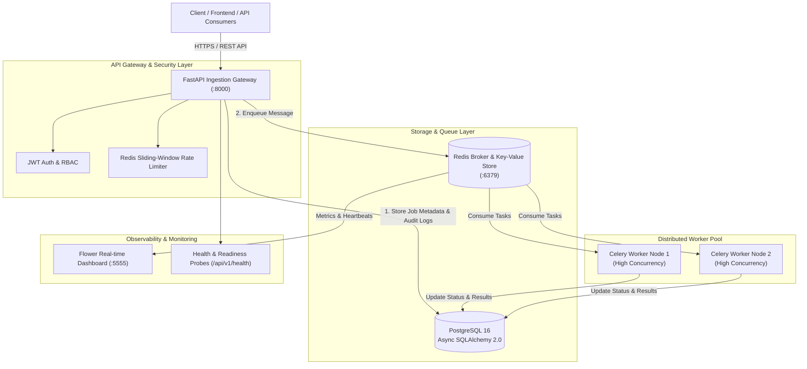

# ⚡ Distributed Task & Job Processing Engine

[](https://github.com/prachizala/distributed-task-engine/actions/workflows/ci.yml)
[](https://www.python.org/)
[](https://fastapi.tiangolo.com)
[](https://docs.celeryq.dev/)
[](https://redis.io/)
[](https://www.postgresql.org/)
[](https://www.docker.com/)
[](LICENSE)

An enterprise-grade, cloud-native distributed task queue and asynchronous job processing system engineered with **FastAPI**, **Celery**, **Redis**, **PostgreSQL (Async SQLAlchemy 2.0)**, **Docker Compose**, and automated **GitHub Actions CI/CD**.

Designed to offload resource-intensive workloads (ETL ingestion, PDF compilation, analytics pipelines, batch notifications) into asynchronous worker pools with persistent audit logs and sliding-window rate limiting.

---

## 🏛️ System Architecture



---

## 🚀 Key Architectural Capabilities

| Capability | Technical Implementation | Value |
|---|---|---|
| **Non-Blocking Ingestion** | FastAPI async endpoints + Uvicorn ASGI | Sub-millisecond job admission and horizontal throughput |
| **Distributed Task Queue** | Celery 5.4 + Redis 7 Broker | Handles heavy computation and external I/O without blocking user threads |
| **Persistent Audit Logging** | PostgreSQL 16 + Async SQLAlchemy 2.0 | Complete execution history, error traces, and duration profiling |
| **Intelligent Rate Limiting** | Redis Sliding Window / Token-Bucket (`ZADD`/`ZREMRANGEBYSCORE`) | Prevents API degradation from traffic spikes or DDoS |
| **Container Orchestration** | Multi-stage Dockerfile + Docker Compose | 1-command deployment for API, Workers, PostgreSQL, Redis, and Flower |
| **CI/CD Quality Gate** | GitHub Actions Workflow (`ci.yml`) | Multi-version Python matrix test, Ruff linting, and Docker build verification |

---

## 🛠️ Technology Stack

- **Framework**: [FastAPI](https://fastapi.tiangolo.com/) (ASGI, OpenAPI 3.1, Swagger UI)
- **Task Queue**: [Celery](https://docs.celeryq.dev/) (Distributed execution, late-acknowledgment, exponential backoff)
- **Message Broker & Cache**: [Redis](https://redis.io/) (In-memory broker, sliding-window rate limiting)
- **Relational Database**: [PostgreSQL](https://www.postgresql.org/) (AsyncPG driver, Declarative Base, Relational mappings)
- **ORM**: [SQLAlchemy 2.0](https://www.sqlalchemy.org/) (AsyncSession, selectinload query optimization)
- **Containerization**: [Docker](https://www.docker.com/) & [Docker Compose](https://docs.docker.com/compose/) (Multi-stage build <120MB, non-root security)
- **Testing & Quality**: [Pytest](https://pytest.org/), `pytest-asyncio`, [Ruff](https://docs.astral.sh/ruff/)

---

## 🔌 API Endpoints Reference

| Method | Endpoint | Description | Authentication |
|---|---|---|---|
| `GET` | `/` | Service health & metadata overview | Public |
| `GET` | `/api/v1/health` | Deep component probe (Database, Redis, Worker ping) | Public |
| `POST` | `/api/v1/auth/register` | Register new user (Admin / Operator / Viewer) | Public |
| `POST` | `/api/v1/auth/login` | OAuth2 password flow & JWT token issuance | Public |
| `POST` | `/api/v1/tasks/submit` | Enqueue asynchronous task with priority & payload | Rate-limited |
| `GET` | `/api/v1/tasks/{job_id}` | Retrieve task lifecycle status, results & audit logs | Public |
| `GET` | `/api/v1/tasks` | Paginated task list with status & name filters | Public |
| `GET` | `/api/v1/tasks/metrics/summary` | Real-time aggregate metrics & duration analytics | Public |

---

## ⚡ Quickstart

### 1. Using Docker Compose (Recommended - Production Stack)

Clone and spin up the complete 5-container infrastructure:

```bash
git clone https://github.com/prachizala/distributed-task-engine.git
cd distributed-task-engine

# Build and start PostgreSQL, Redis, API, Celery Worker, and Flower
docker compose -f docker/docker-compose.yml up --build -d
```

- **Interactive Swagger Documentation**: `http://localhost:8000/docs`
- **ReDoc Documentation**: `http://localhost:8000/redoc`
- **Flower Worker Dashboard**: `http://localhost:5555`

---

### 2. Local Development (Lightweight Standalone)

```bash
# 1. Create and activate virtual environment
python -m venv .venv
source .venv/bin/activate  # On Windows: .venv\Scripts\activate

# 2. Install dependencies
pip install -r requirements.txt

# 3. Launch FastAPI server (uses lightweight async SQLite fallback automatically)
uvicorn app.main:app --reload --port 8000
```

---

## 🧪 Testing & Verification

Comprehensive test suite covering authentication, task lifecycle, rate limiting, and health probes:

```bash
# Run pytest with async support
pytest -v

# Run code style & linting check
ruff check .
ruff format --check .
```

---

## 👤 Author & Contributor

**Prachi Zala**  
- GitHub: [@prachizala](https://github.com/prachizala)  
- Portfolio: [prachizala.github.io/prachi-portfolio](https://prachizala.github.io/prachi-portfolio/)  
- Role: 6× Hackathon Team Leader | Python, FastAPI & Distributed Systems Engineer

---

## 📄 License

This project is licensed under the MIT License — see the [LICENSE](LICENSE) file for details.
